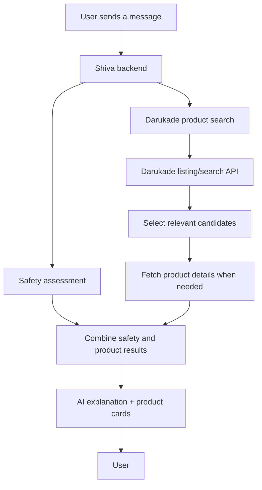

# Shiva — Direct Darukade API Integration

> **Purpose:** Shiva retrieves product data directly from Darukade. The SiteHarvest catalog database is no longer part of the product-search or product-detail flow.
>
> **Primary goal:** Reduce response latency while preserving accurate product information, category search, ingredient search, product cards, and Shiva's safety pipeline.

## 1. Architecture



Safety assessment and product retrieval should run independently where possible. A product lookup must not delay the initial safety assessment, and the system must not wait for unnecessary product-detail requests.

Darukade is the source of truth for catalog information. Shiva's existing application database may continue storing chats and messages, but it must not be required to retrieve catalog products.

## 2. Darukade endpoints

### Product listing and search

Known endpoint pattern:

```text
https://darukade.com/_next/data/{BUILD_ID}/products.json?w={QUERY}
```

Example:

```text
https://darukade.com/_next/data/wDG6jXI_bYlEl2FE7Xpaf/products.json?w=Creatine
```

The build ID is not permanent. Discover the current identifier dynamically and handle changes gracefully.

Listing results have been observed to include:

- `id`
- `faName`
- `productURL`
- `brandEnName`
- `brandURL`
- `image`
- `orginalCost`
- `discountCost`
- `discountPercent`
- `storeState`
- `storeCount`
- `rank`
- `slaveTitle`
- `slaveTypeTitle`
- `slaveCount`
- `quickBuy`
- `freeDelivery`

Response fields may vary. Validate the actual payload and handle missing data without crashing.

Use listing results for initial product discovery. Do not fetch every product's full page for every search request.

### Product details

Product pages embed structured JSON inside:

```html
<script id="__NEXT_DATA__" type="application/json">
  ...
</script>
```

The observed metadata path is:

```text
props.pageProps.productMataData
```

Parse the HTML response and extract the JSON instead of scraping visible text wherever structured data is available.

Detailed data may include ingredients, serving amounts, package variants, prices, images, and expiration information. Verify each field before using it.

### Related products

Known endpoint:

```text
https://darukade.com/api/products/fetchrelated?id={PRODUCT_ID}
```

The response may contain:

- `relatedProducts`
- `sameBrandProducts`
- `complementaryProducts`
- `alternativeProducts`
- `similarProducts`

Use this endpoint when related-product discovery is useful. It is not required for every ordinary search.

## 3. Backend implementation

Create a dedicated Darukade service module. All requests to Darukade must be made server-side.

Recommended responsibilities:

- `searchProducts(query, options)` — fetch listing results.
- `getProductDetails(productUrl)` — fetch and parse embedded product metadata.
- `getRelatedProducts(productId)` — retrieve related-product groups.
- `searchProductsByCategory(category, options)` — use verified Darukade category navigation or listing parameters.
- `searchProductsByIngredient(ingredient, options)` — find candidates using source-supported search and inspect structured ingredient data where necessary.

These are recommended interfaces, not assertions that the functions already exist. Adapt their names to the repository's current conventions.

### Search pipeline

1. Normalize the user's search query.
2. Request the relevant Darukade listing results.
3. Parse and validate the response.
4. Rank the returned candidates using deterministic rules.
5. Fetch detailed product data only for candidates that need it.
6. Apply ingredient and safety constraints using verified data.
7. Return a small set of products to the UI and AI response layer.

Use bounded concurrency, request timeouts, and short-lived request deduplication to avoid duplicate requests for the same product.

Do not download all 7,000+ products for a user query. Do not pass the complete catalog into the AI prompt.

## 4. Latency requirements

The current 8–10 second response time is unacceptable for the intended pharmacy workflow. The direct API migration must be measured rather than assumed to solve the delay.

- Run safety assessment and product retrieval in parallel.
- Avoid sequential requests when data can be fetched independently.
- Use listing data for product cards when it contains all required fields.
- Fetch product details only when necessary for ingredients, serving amounts, warnings, or other missing information.
- Deduplicate concurrent requests for the same URL.
- Set bounded timeouts and handle failed upstream requests gracefully.
- Avoid calling the related-products endpoint unless the user request benefits from it.
- Stream the assistant response where supported by the existing UI.
- Record timings for listing requests, detail requests, safety assessment, AI generation, and total response time.

If Darukade is slow or unavailable, return an honest partial result or a clear retry message. Never fabricate product details or claim that unverified product data is current.

Do not introduce a replacement catalog database, a background catalog synchronization job, or a local full-catalog copy as part of this migration.

## 5. Product data and accuracy

Map Darukade's source fields into Shiva's existing product-card interface.

- Use source names and brand information as returned.
- Preserve the original Persian values.
- Use English names only when the source provides them or a separately verified translation exists.
- Use source prices and clearly define which variant they refer to.
- Do not assume the original price is the current price.
- Do not assume a listing result means the product is in stock.
- Do not invent barcodes, ingredients, manufacturers, descriptions, or category relationships.
- If ingredient information is unavailable, mark it as unknown rather than claiming the product does not contain an ingredient.

Preserve the current product-card design and detail views. Change the data source, not the established UI design system.

## 6. Category and ingredient search

Use Darukade's actual category data and supported search parameters.

Do not invent an undocumented category endpoint or build an authoritative hierarchy from product-name guesses. Inspect category pages, embedded page data, navigation information, and network requests to identify the correct structure.

Ingredient search must use structured ingredient information when available. A product listing's name alone is not proof that it contains a particular ingredient.

If detailed ingredient data requires a product-page request, fetch it selectively and communicate uncertainty when the source does not provide enough information.

## 7. Database removal

The SiteHarvest catalog database must no longer be used by Shiva.

### Remove from the product flow

Remove catalog reads, writes, and synchronization dependencies involving these SiteHarvest tables, if they exist:

- `sources`
- `crawls`
- `pages`
- `categories`
- `products`
- `product_categories`
- `ingredients`
- `product_ingredients`
- `technologies`
- `crawl_urls`
- `crawl_errors`

Also remove catalog-specific RPCs, triggers, indexes, and migration dependencies that are no longer needed.

Before dropping anything, inspect the actual migrations, foreign keys, views, functions, and application references. Only remove objects belonging to the retired SiteHarvest catalog integration.

### Preserve application data

**Do not drop `chats` or `chat_messages`.** They belong to Shiva's application and store consultation history, not the SiteHarvest product catalog.

Preserve authentication tables, user records, and any other tables required by the running application.

### Safe migration sequence

1. Find every application query and server function that reads the SiteHarvest catalog.
2. Replace those calls with the Darukade service.
3. Update product cards, detail views, category search, and ingredient search.
4. Remove catalog-specific environment variables and code that are no longer needed.
5. Verify the application no longer depends on the catalog tables or RPCs.
6. Test the full product and safety workflows.
7. Drop the obsolete catalog objects through a reviewed database migration.
8. Verify chat history, authentication, and unrelated features still work.

Do not delete tables before their dependencies have been migrated. Removing a table does not automatically remove every application-level reference to it.

## 8. Security and reliability

- Keep all Darukade requests on the server.
- Do not expose privileged credentials to the browser.
- Validate URLs before fetching product pages; restrict requests to the intended Darukade host to avoid server-side request forgery.
- Use timeouts, bounded retries, and controlled concurrency.
- Handle malformed JSON, changed response shapes, missing products, and upstream errors.
- Respect source access rules and applicable rate limits.
- Never treat AI-generated product details as a substitute for source data.

## 9. Acceptance criteria

The migration is complete when:

- [ ] Shiva retrieves product listings directly from Darukade.
- [ ] Product details and ingredients are fetched directly when needed.
- [ ] Product cards display source-backed information.
- [ ] Category and ingredient search work without SiteHarvest catalog tables.
- [ ] The safety pipeline still runs independently of product retrieval.
- [ ] No product-search path depends on the retired catalog database.
- [ ] `chats`, `chat_messages`, authentication, and user history remain intact.
- [ ] The project passes tests, type checks, linting, and production build.
- [ ] Response timing is measured before and after the migration.
- [ ] Failed or incomplete upstream requests do not generate fabricated product information.

**Architecture rule:** Darukade is the live catalog source. Shiva's application database stores application data, not a duplicated SiteHarvest product catalog.
