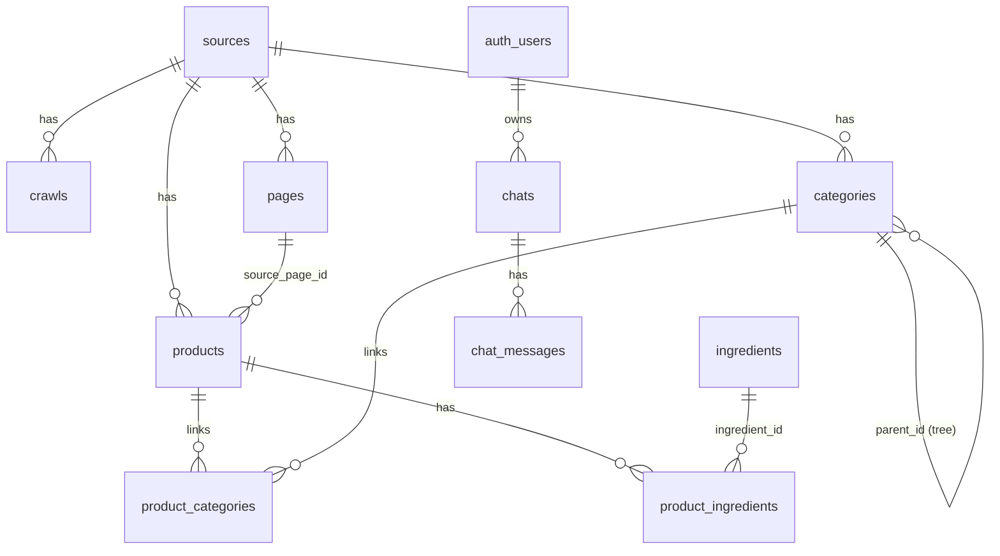

# SiteHarvest Database Usage Guide

> **Audience:** AI agents, LLM tools, and developers reading this repository.
> This file is the single source of truth for querying the SiteHarvest Postgres database (hosted on Supabase).

SiteHarvest crawls an e-commerce/catalog site (e.g. darukade.com) and normalizes it into a relational schema that an AI assistant can query to:

- look up products by Persian or English name, brand, SKU or barcode,
- read full ingredients (bilingual, with amounts/units),
- navigate the nested category tree,
- power "red flag" checks and supplement recommendations.

---

## 1. Connection

| Env var                     | Purpose                                                         |
| --------------------------- | --------------------------------------------------------------- |
| `SUPABASE_URL`              | `https://<project-ref>.supabase.co`                             |
| `SUPABASE_SERVICE_ROLE_KEY` | Service-role key (server-side reads/writes)                     |
| `SUPABASE_ACCESS_TOKEN`     | Personal access token — only used by `db:init` (Management API) |
| `SUPABASE_ANON_KEY`         | Anon key — used only by the server-side auth client             |

AI agents should read with the **service-role key** (or a Postgres connection string from the Supabase dashboard).

---

## 2. Schema

### `sources`

One row per crawled website.

| column         | type  | notes                                      |
| -------------- | ----- | ------------------------------------------ |
| `id`           | uuid  | primary key                                |
| `base_url`     | text  | unique origin, e.g. `https://darukade.com` |
| `name`         | text  | optional display name                      |
| `technologies` | jsonb | detected stack                             |

### `crawls`

One row per crawl run.

| column                                   | type    | notes                                               |
| ---------------------------------------- | ------- | --------------------------------------------------- |
| `id`                                     | uuid    | primary key (the "crawl id")                        |
| `source_id`                              | uuid    | FK → `sources.id`                                   |
| `status`                                 | text    | `running` \| `completed` \| `failed` \| `cancelled` |
| `pages_seen`, `products_found`, `errors` | integer | counters                                            |
| `metadata`                               | jsonb   | crawl options (maxPages, productOnly, …)            |

### `pages`

Raw crawled pages (HTML stored only if `--store-raw-html` was used).

| column                                 | type  | notes                                                    |
| -------------------------------------- | ----- | -------------------------------------------------------- |
| `id`                                   | uuid  | primary key                                              |
| `source_id`                            | uuid  | FK → `sources.id`                                        |
| `url`                                  | text  | unique                                                   |
| `canonical_url`                        | text  |                                                          |
| `title`, `description`, `content_type` | text  |                                                          |
| `raw_html`                             | text  | nullable                                                 |
| `content_text`                         | text  | extracted main text                                      |
| `partitions`                           | jsonb | structured content (metadata, JSON-LD, tables, sections) |

### `categories`

Self-referencing category **tree**.

| column        | type  | notes                                                       |
| ------------- | ----- | ----------------------------------------------------------- |
| `id`          | uuid  | primary key                                                 |
| `source_id`   | uuid  | FK → `sources.id`                                           |
| `name`        | text  | category name (Persian on darukade)                         |
| `slug`        | text  |                                                             |
| `parent_id`   | uuid  | FK → `categories.id` (`NULL` = root) — **this is the tree** |
| `parent_name` | text  | denormalized parent name                                    |
| `source_url`  | text  |                                                             |
| `breadcrumbs` | jsonb | `string[]` path from root to this category                  |

- `unique(source_id, name)` — a category name is unique per source.
- A product links to its **leaf** category only; ancestors are reached by walking `parent_id`.

### `products`

The core entity.

| column                     | type        | notes                                                          |
| -------------------------- | ----------- | -------------------------------------------------------------- |
| `id`                       | uuid        | primary key                                                    |
| `source_id`                | uuid        | FK → `sources.id`                                              |
| `source_page_id`           | uuid        | FK → `pages.id`                                                |
| `canonical_url`            | text        | product URL; unique per source                                 |
| `name`                     | text        | primary display name (Persian on darukade)                     |
| `name_en`                  | text        | English name (when available)                                  |
| `name_fa`                  | text        | Persian name (when available)                                  |
| `slug`                     | text        | URL-friendly name                                              |
| `brand`                    | text        |                                                                |
| `description`              | text        |                                                                |
| `sku`                      | text        |                                                                |
| `barcode`                  | text        | GTIN/EAN                                                       |
| `price`                    | numeric     |                                                                |
| `currency`                 | text        | `IRT` (Toman), `IRR` (Rial), `USD`, `EUR`                      |
| `availability`             | text        | normalized: `InStock`, `OutOfStock`, `PreOrder`, …             |
| `manufacturer`             | text        |                                                                |
| `form`                     | text        | e.g. tablet, capsule, liquid                                   |
| `package_size`             | text        | e.g. "30", "1 بطری (40 میلی لیتر)"                             |
| `image_urls`               | jsonb       | `string[]`                                                     |
| `attributes`               | jsonb       | extra key/value data (englishName, rate, ingredientServing, …) |
| `source_payload`           | jsonb       | **full raw extracted product record** (see §5)                 |
| `search_vector`            | tsvector    | generated — see §4                                             |
| `created_at`, `updated_at` | timestamptz |                                                                |

### `product_categories`

M:N link from product → leaf category.

| column        | type                                |
| ------------- | ----------------------------------- |
| `product_id`  | uuid FK → `products.id` (cascade)   |
| `category_id` | uuid FK → `categories.id` (cascade) |

Primary key: `(product_id, category_id)`.

### `ingredients`

Global ingredient dictionary (shared across products).

| column            | type  | notes                                                |
| ----------------- | ----- | ---------------------------------------------------- |
| `id`              | uuid  | primary key                                          |
| `canonical_name`  | text  | unique; **English when available**, else source name |
| `persian_name`    | text  | Persian name (when available)                        |
| `aliases`         | jsonb | `string[]`                                           |
| `ingredient_type` | text  |                                                      |
| `description`     | text  |                                                      |
| `metadata`        | jsonb |                                                      |

### `product_ingredients`

Per-product ingredient amounts.

| column          | type    | notes                             |
| --------------- | ------- | --------------------------------- |
| `product_id`    | uuid    | FK → `products.id` (cascade)      |
| `ingredient_id` | uuid    | FK → `ingredients.id` (cascade)   |
| `amount`        | numeric | quantity per serving              |
| `unit`          | text    | `mg`, `g`, `IU`, …                |
| `form`          | text    |                                   |
| `raw_name`      | text    | label as shown on the source page |

Primary key: `(product_id, ingredient_id)`.

### Other tables

- `technologies` — detected tech per name (shared).
- `crawl_urls` — internal crawl queue (status, attempts, leases).
- `crawl_errors` — logged crawl failures.

### `chats` (application — one row per consultation)

Created by the chat UI when a new consultation starts. The title and icon are
chosen by the app: a deterministic lucide icon slug picked from the first
message, and a short AI-written title that replaces the provisional one.

| column                     | type        | notes                                                       |
| -------------------------- | ----------- | ----------------------------------------------------------- |
| `id`                       | uuid        | primary key                                                 |
| `user_id`                  | uuid        | FK → `auth.users.id` (**cascade**) — the owner               |
| `title`                    | text        | chat name shown in the header and history                   |
| `icon`                     | text        | lucide slug, e.g. `head`, `lung`, `general` (list below)     |
| `status`                   | text        | `open` \| `in_progress` \| `closed`                          |
| `model`                    | text        | `flash` (fast) \| `pro` (deep thinking) — the latest mode    |
| `created_at`, `updated_at` | timestamptz | `updated_at` maintained by the `set_updated_at` trigger      |

### `chat_messages` (application — transcript)

One row per turn, in stream order.

| column       | type        | notes                                                             |
| ------------ | ----------- | ----------------------------------------------------------------- |
| `id`         | uuid        | primary key                                                       |
| `chat_id`    | uuid        | FK → `chats.id` (**cascade**)                                     |
| `role`       | text        | `user` \| `assistant`                                             |
| `content`    | text        | the message text                                                  |
| `thinking`   | text        | nullable — the model's reasoning trace, shown in the Thinking tab |
| `status`     | text        | `complete` \| `error`                                             |
| `safety`     | jsonb       | nullable — the deterministic safety assessment                    |
| `products`   | jsonb       | nullable — the recommended products attached to the answer        |
| `created_at` | timestamptz | ordering key (ascending)                                          |

**RLS is enabled on both tables** (unlike the catalog tables, which have it
disabled). Each has one policy allowing a signed-in user to `select`/`insert`/
`update`/`delete` only rows they own. The app's data layer additionally uses the
service role and always filters by `user_id` explicitly, so RLS is
defence-in-depth. Signing out and back in as another user must never surface
someone else's chats.

`chats.icon` is a lucide icon **slug**, not a component name — the app maps
slug → component in `components/history/HistoryCard.tsx` (`CHAT_ICON_COMPONENTS`).
Known slugs: `general`, `head`, `eye`, `ear`, `stomach`, `back`, `joint`,
`heart`, `skin`, `cold`, `lung`, `allergy`, `sleep`, `baby`, `infection`,
`medicine`, `mind`.

---

## 3. Relationships



- **Product → category:** a product links to its leaf category; traverse `categories.parent_id` to get the full path.
- **Product → ingredients:** join through `product_ingredients`; the amount/unit live on the join row.
- **User → chats → messages:** `chats.user_id` → `auth.users.id` and `chat_messages.chat_id` → `chats.id`, both `on delete cascade` (deleting a user removes their whole history).

---

## 4. Search

`products.search_vector` is a generated `tsvector` over:
`name`, `name_en`, `brand` (weight A) + `sku`, `barcode`, `manufacturer` (weight B) + `description` (weight C).

Use the SQL function for ranked + fuzzy search:

```sql
select * from search_products('vitamin c');
select * from search_products('ویتامین سی');
select * from search_products('28993');   -- matches SKU-ish tokens
```

It returns `(id, name, name_en, brand, description, rank)` and also falls back to trigram similarity on `name`, `name_en`, `brand`.

---

## 5. Common queries

### 5.1 Full product with ingredients (flat join)

```sql
select
  p.id,
  p.canonical_url,
  p.name, p.name_en, p.name_fa, p.slug,
  p.brand, p.description, p.sku, p.barcode,
  p.price, p.currency, p.availability,
  p.manufacturer, p.form, p.package_size,
  p.image_urls, p.attributes,
  coalesce(jsonb_agg(
    jsonb_build_object(
      'name', i.canonical_name,
      'name_en', i.canonical_name,
      'name_fa', i.persian_name,
      'amount', pi.amount, 'unit', pi.unit, 'form', pi.form,
      'raw_name', pi.raw_name
    ) order by pi.amount desc
  ) filter (where i.id is not null), '[]'::jsonb) as ingredients
from products p
left join product_ingredients pi on pi.product_id = p.id
left join ingredients i on i.id = pi.ingredient_id
where p.id = :product_id
group by p.id;
```

> Simpler alternative for AI agents: `products.source_payload` already contains the full extracted record, including a `breadcrumbs` array, `ingredients` array (with `name`, `nameEn`, `nameFa`, `amount`, `unit`), `imageUrls`, and `attributes`. One `select source_payload from products where id = :id;` gives the raw structured JSON without joins.

### 5.2 Category path of a product (ancestors)

```sql
with recursive chain as (
  select c.id, c.name, c.slug, c.parent_id, 0 as depth
  from categories c
  where c.id = (
    select category_id from product_categories where product_id = :product_id limit 1
  )
  union all
  select c.id, c.name, c.slug, c.parent_id, ch.depth + 1
  from categories c
  join chain ch on c.id = ch.parent_id
)
select id, name, slug, depth from chain order by depth desc;  -- root first
```

### 5.3 All products in a category (including subcategories)

```sql
with recursive subtree as (
  select id from categories where id = :category_id
  union all
  select c.id from categories c join subtree s on c.parent_id = s.id
)
select p.id, p.name, p.name_en, p.brand, p.price, p.currency
from products p
join product_categories pc on pc.product_id = p.id
join subtree s on s.id = pc.category_id;
```

### 5.4 Products containing an ingredient

```sql
select p.id, p.name, p.name_en, p.brand, pi.amount, pi.unit
from products p
join product_ingredients pi on pi.product_id = p.id
join ingredients i on i.id = pi.ingredient_id
where i.canonical_name ilike '%iron%'
   or i.persian_name ilike '%آهن%';
```

### 5.5 Find by SKU or barcode

```sql
select * from products where sku = 'D-28993';
select * from products where barcode = '6260000000000';
```

### 5.6 Category tree

```sql
select id, name, slug, parent_id, parent_name, breadcrumbs
from categories
where source_id = :source_id
order by breadcrumbs;
```

> There is **no separate "parent categories" table**. A parent category is just a row whose `id` appears in another row's `parent_id` (top-level parents have `parent_id IS NULL`). Query the tree with the snippets below instead of joining across tables.

### 5.7 Top-level (parent) categories

```sql
select id, name, slug, breadcrumbs
from categories
where source_id = :source_id and parent_id is null
order by name;
```

### 5.8 Direct subcategories of a category

```sql
select id, name, slug, breadcrumbs
from categories
where parent_id = :category_id
order by name;
```

### 5.9 All descendants of a category (sub + sub-sub, …)

```sql
with recursive subtree as (
  select id from categories where id = :category_id
  union all
  select c.id from categories c join subtree s on c.parent_id = s.id
)
select c.id, c.name, c.slug, c.parent_id, c.breadcrumbs
from categories c
join subtree s on s.id = c.id;
```

---

## 6. Field semantics (important for AI agents)

- **Bilingual names:** `name` is the source's primary display name (Persian on darukade). `name_en` and `name_fa` may be identical to `name` or `null`. Prefer `name_en` for English matching, `name`/`name_fa` for Persian.
- **Ingredients:** `ingredients.canonical_name` is English when the source provides it; `persian_name` is the Persian label. Amount/unit are per-serving and live on `product_ingredients`.
- **Availability:** normalized to short tokens — `InStock`, `OutOfStock`, `PreOrder`, `Discontinued`, `SoldOut`, etc. (the `schema.org` URL prefix is stripped).
- **Currency caveat:** some Persian sites list prices in Toman but label them `IRR` in their JSON-LD. Verify per source; `IRT` = Toman, `IRR` = Rial (1 Toman = 10 Rial).
- **Categories:** `product_categories` holds only the leaf. Use `parent_id` recursion for ancestors. The full path is also stored in `categories.breadcrumbs` (jsonb array, root→leaf).

---

## 7. Supabase JS examples (for AI agents)

```js
import { createClient } from "@supabase/supabase-js";
const sb = createClient(
  process.env.SUPABASE_URL,
  process.env.SUPABASE_SERVICE_ROLE_KEY,
);

// Full product + ingredients + leaf category
const { data: product } = await sb
  .from("products")
  .select(
    "*, product_ingredients(amount, unit, form, raw_name, ingredient:ingredients(canonical_name, persian_name, aliases)), product_categories(category:categories(id, name, slug, parent_id, parent_name, breadcrumbs))",
  )
  .eq("id", productId)
  .limit(1)
  .single();

// Search (uses the search_products RPC)
const { data: hits } = await sb.rpc("search_products", {
  search_query: "ویتامین سی",
  result_limit: 10,
});
```

---

## 8. JSON export

`npm run dev -- export products.json --limit 10000` writes `{ "products": [...] }` where each product has:

```json
{
  "id": "uuid",
  "url": "https://...",
  "name": "قرص آهن",
  "name_en": "Ferrous Sulfate Tablet",
  "name_fa": "قرص آهن",
  "slug": "ferrous-sulfate-tablet",
  "brand": "…",
  "description": "…",
  "sku": "24101",
  "barcode": "6260000000000",
  "price": 120000,
  "currency": "IRT",
  "availability": "InStock",
  "manufacturer": "…",
  "form": "tablet",
  "package_size": "30",
  "images": ["https://..."],
  "categories": [
    { "id": "…", "name": "…", "parent_id": null, "breadcrumbs": ["…"] }
  ],
  "ingredients": [
    {
      "name": "Iron",
      "name_en": "Iron",
      "name_fa": "آهن",
      "amount": 50,
      "unit": "mg"
    }
  ],
  "attributes": {}
}
```

---

## 9. CLI commands that write this data

| Command                                             | Effect                                            |
| --------------------------------------------------- | ------------------------------------------------- |
| `db:init`                                           | apply migrations (schema + RPCs)                  |
| `crawl <url> --product-only --all --store-raw-html` | crawl a site into the schema                      |
| `rebuild-categories <source-id>`                    | rebuild the nested category tree from breadcrumbs |
| `export <file> --limit N`                           | dump normalized products to JSON                  |
